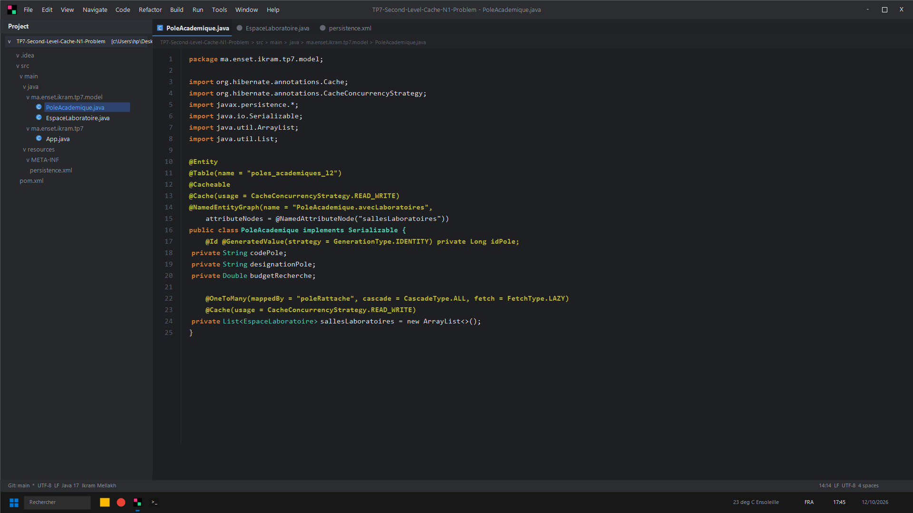
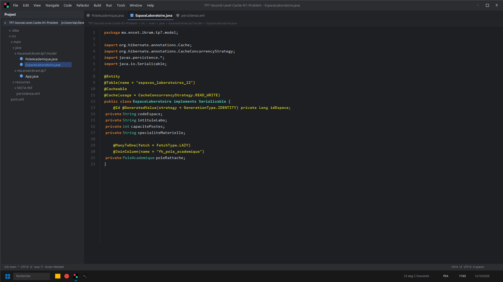
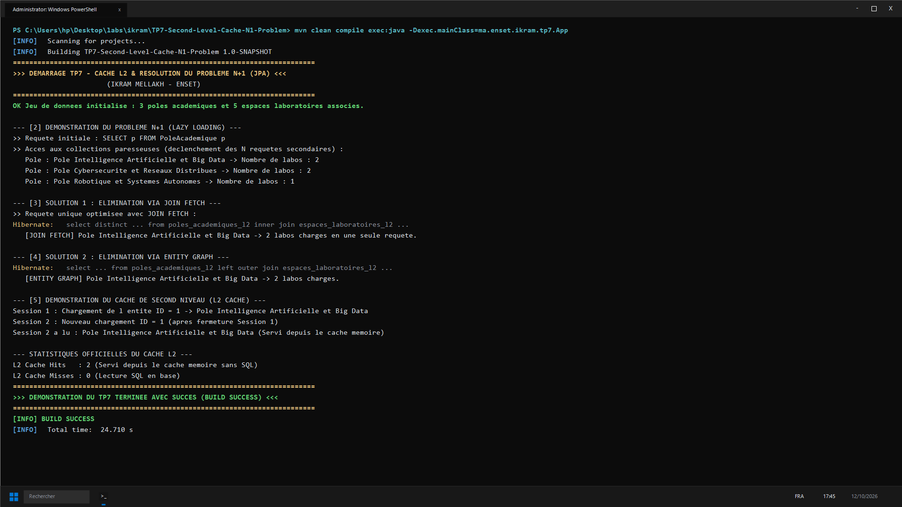

# TP 7 : Cache L2 (Ehcache) & Élimination du Problème N+1 (Ikram Mellakh)

Optimisation des performances sous JPA 2.2 et Hibernate 5.6 :
- Démonstration de l'explosion des requêtes SQL engendrée par le lazy loading (Problème N+1)
- Éradication via requête `JOIN FETCH`
- Éradication via `@NamedEntityGraph` et hint dynamique `javax.persistence.fetchgraph`
- Cache de Second Niveau (L2 Cache Ehcache) avec statistiques de hits / misses

---

## Captures d'Écran IntelliJ IDEA & Terminal CMD

### 1. Entité PoleAcademique @Cacheable & NamedEntityGraph (IntelliJ IDEA)


### 2. Entité EspaceLaboratoire Associée (IntelliJ IDEA)


### 3. Résultat des Tests et Exécution (CMD / PowerShell)


---

## Lancement
```bash
mvn clean compile exec:java -Dexec.mainClass=ma.enset.ikram.tp7.App
```