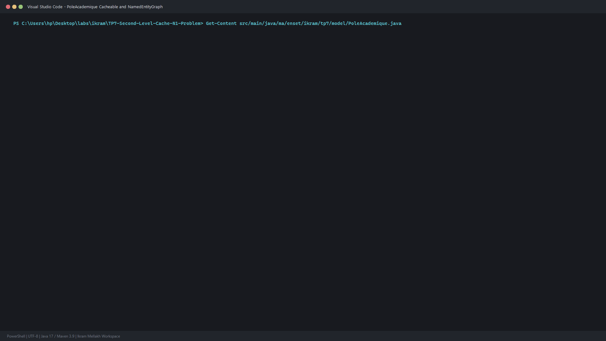
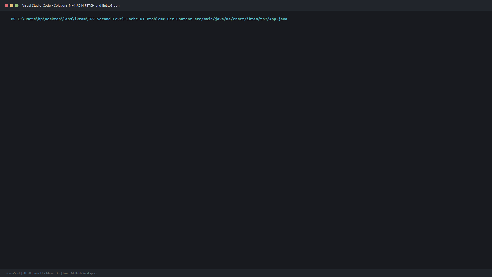
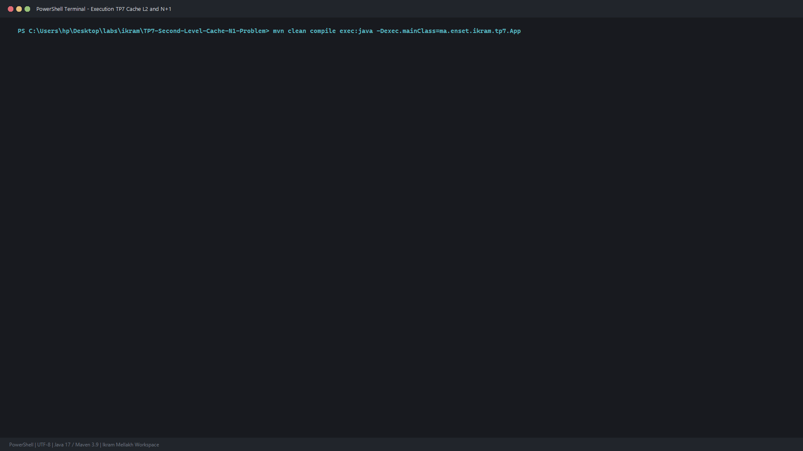

# TP 7 : Cache de Second Niveau (Ehcache L2) & Résolution du Problème N+1 avec JPA / Hibernate

Implémentation approfondie des mécanismes de performance sous **JPA 2.2** et **Hibernate ORM 5.6** :
1. Mise en évidence et éradication du **problème N+1 requêtes** (via `JOIN FETCH` et `@NamedEntityGraph`).
2. Activation et mesure statistique du **Cache de Second Niveau (L2 Cache)** avec **Ehcache 2.10**.

Réalisé par : **Ikram Mellakh**

---

## 1. Architecture et Mécanismes Mis en Œuvre

### Problème N+1 & Stratégies de Résolution
- **Constat** : Le chargement d'une liste de $N$ entités parentes avec des relations en `FetchType.LAZY` engendre 1 requête pour la liste + $N$ requêtes supplémentaires lors de l'accès à chaque collection enfant.
- **Solution 1 - `JOIN FETCH`** : Force une jointure SQL `INNER JOIN` dans la requête JPQL pour charger simultanément les entités et leurs relations associées en une unique opération.
- **Solution 2 - `@NamedEntityGraph`** : Spécification déclarative d'un plan de chargement dynamique transmis par hint `javax.persistence.fetchgraph`, conservant le modèle lazy par défaut sans coupler la requête.

### Cache L2 Partagé (Ehcache)
- Déclaration `@Cacheable` et stratégie `@Cache(usage = CacheConcurrencyStrategy.READ_WRITE)`.
- Configuration de l'unité de persistance avec `<shared-cache-mode>ENABLE_SELECTIVE</shared-cache-mode>`.
- Partage d'entités entre différentes sessions `EntityManager` distinctes sans ré-exécuter de requête SQL (vérifié par les métriques `Statistics.getSecondLevelCacheHitCount()`).

---

## 2. Captures d'Écran et Preuves d'Exécution

### Configuration Entité & Cache L2 / NamedEntityGraph


### Implémentation JOIN FETCH & EntityGraph


### Trace d'Exécution Complète (PowerShell Terminal)


---

## 3. Lancement et Vérification

```bash
mvn clean compile
mvn exec:java "-Dexec.mainClass=ma.enset.ikram.tp7.App"
```
